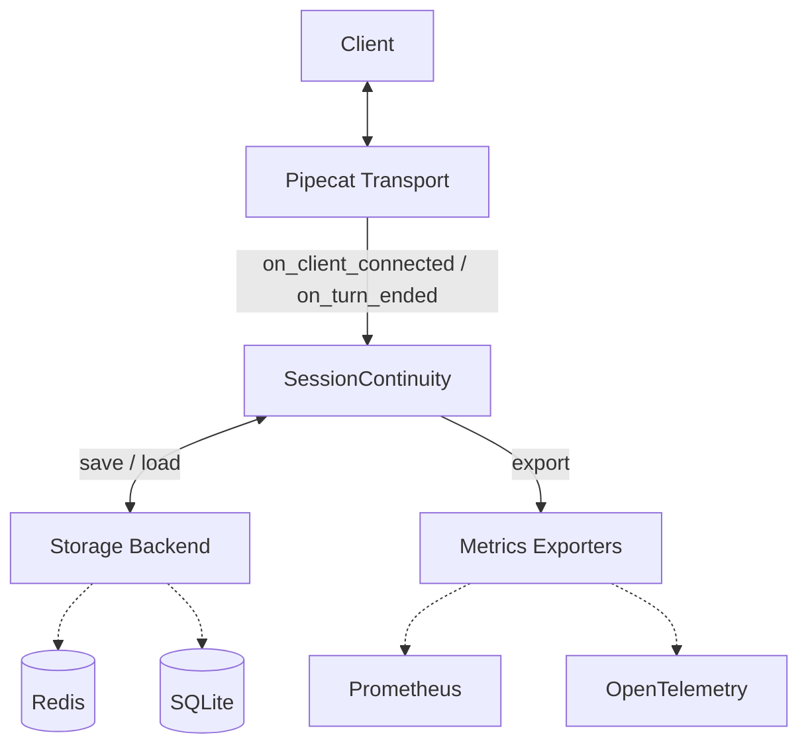

# pipecat-session-continuity

[](https://pypi.org/project/pipecat-session-continuity/)
[](https://github.com/meet987654/pipecat-session-continuity/actions)
[](https://opensource.org/licenses/MIT)
[](https://www.python.org/downloads/)

**Drop-in session continuity & connection resilience for Pipecat 1.5 voice agents.**

When a client disconnects (network drop, browser refresh, mobile backgrounding), this library saves the LLM context + pending tool calls and restores them cleanly on reconnect — so the conversation continues instead of starting over.

---

## Features
- **Default SQLite storage**: Zero-config local development out of the box (persists to `pipecat_sessions.db` with no Redis or Docker needed)
- **Production Redis storage**: Seamless scale-out via `redis_url` or custom storage backends
- Secure session tokens with HMAC signature (prevents session forgery)
- Resume conversation state on client reconnect
- **Robust tool-call idempotency**: Deterministic keys (tool_name + canonical arguments hash), client-side tokens, and dual-index lookup to prevent duplicate actions even if LLM generates new `tool_call_id`s on reconnect
- Stronger contextual system prompts injected on resume for pending and completed tools
- **Prometheus & OpenTelemetry metrics export**: Production-ready observability for checkpoint latency (histograms), resume success/error rates, reconnect counts, and tool execution status
- Simple drop-in API designed for Pipecat event handlers
- Explicitly documented limitations (production-ready honesty)

## Installation
```bash
pip install pipecat-session-continuity

# With Prometheus support:
pip install "pipecat-session-continuity[prometheus]"

# With OpenTelemetry support:
pip install "pipecat-session-continuity[opentelemetry]"
```

## Quick Start

### Option A: Native Zero-Boilerplate Pipeline Integration (Recommended)

Simply insert `continuity.processor(session_id, context)` directly into your Pipecat `Pipeline`. It automatically intercepts turn boundaries (`LLMFullResponseEndFrame`, `BotStoppedSpeakingFrame`, `FunctionCallResultFrame`, `EndFrame`) and saves checkpoints non-blockingly with zero audio latency penalty:

```python
from pipecat.pipeline.pipeline import Pipeline
from pipecat_session_continuity import SessionContinuity

continuity = SessionContinuity()  # Defaults to SQLite ("pipecat_sessions.db")

pipeline = Pipeline([
    transport.input(),
    stt,
    continuity.processor(session_id, context),
    llm,
    tts,
    transport.output(),
])
```

### Option B: Manual Lifecycle Integration

```python
from pipecat_session_continuity import SessionContinuity

# Zero-config: defaults to local SQLiteStorage ("pipecat_sessions.db")
# with optional first-class Prometheus metrics export enabled:
continuity = SessionContinuity(enable_prometheus=True)

# Or specify a custom SQLite db path:
# continuity = SessionContinuity(db_path="my_sessions.db")

# Or connect to Redis for distributed multi-worker production:
# continuity = SessionContinuity(redis_url="redis://localhost:6379", enable_prometheus=True)
```

## Production Observability (Prometheus & OpenTelemetry)

First-class exporters make monitoring checkpoint latency and reconnect reliability effortless in multi-worker production environments.

### Prometheus

Expose standard Prometheus metrics via FastAPI, aiohttp, or Flask:

```python
from fastapi import FastAPI, Response
from pipecat_session_continuity import SessionContinuity

app = FastAPI()
continuity = SessionContinuity(enable_prometheus=True)

@app.get("/metrics")
async def metrics():
    # Returns standard Prometheus exposition format
    return Response(
        content=continuity.get_prometheus_metrics(),
        media_type="text/plain; version=0.0.4"
    )
```

Exported metrics:
- `pipecat_session_checkpoint_latency_ms`: Histogram of context checkpoint save duration with `status` label (`success`, `error`).
- `pipecat_session_checkpoints_total`: Counter of all checkpoint operations.
- `pipecat_session_resume_latency_ms`: Histogram of resume and session startup latencies.
- `pipecat_session_resumes_total`: Counter of resumes with `is_resumed` and `status` labels.
- `pipecat_session_reconnects_total`: Counter of actual client reconnect events.
- `pipecat_session_tool_calls_total`: Counter of tool calls with `tool_name` and `status` labels (`pending`, `completed`, `duplicate`).

### OpenTelemetry

Use the OpenTelemetry Metrics API exporter to forward metrics to OTel collectors (Datadog, Dynatrace, New Relic, Grafana Tempo):

```python
from pipecat_session_continuity import SessionContinuity

continuity = SessionContinuity(enable_opentelemetry=True)
```

## Architecture



## Realistic Failure & Chaos Testing Examples

Production voice applications rarely experience clean disconnects. We provide dedicated, runnable failure scripts in the **[`examples/`](examples/README.md)** directory:

1. **[Hard Process Kill & Recovery](examples/01_hard_process_kill.py)** (`01_hard_process_kill.py`):
   Simulates catastrophic backend termination (`SIGKILL`, OOM, Kubernetes pod eviction) mid-sentence, starts a completely fresh worker process, and resumes state seamlessly with zero duplicate tool executions.
   ```bash
   python examples/01_hard_process_kill.py
   ```

2. **[Simulated Network Failures](examples/02_simulated_network_failures.py)** (`02_simulated_network_failures.py`):
   Simulates transient TCP resets, in-flight action drops (preventing double billing on interrupted payment calls), and mobile backgrounding stale resumes.
   ```bash
   python examples/02_simulated_network_failures.py
   ```

3. **[Client-Side Reconnect Flow & Backoff](examples/03_client_reconnect_flow.py)** (`03_client_reconnect_flow.py`):
   Reference client architecture demonstrating token caching, exponential backoff with full jitter, and client-side idempotency tokens.
   ```bash
   python examples/03_client_reconnect_flow.py
   ```

4. **[Native Pipeline FrameProcessor Integration](examples/04_pipeline_processor.py)** (`04_pipeline_processor.py`):
   Demonstrates zero-boilerplate integration using `continuity.processor(session_id, context)` directly inside a Pipecat `Pipeline`, intercepting completion frames non-blockingly with zero audio latency penalty.
   ```bash
   python examples/04_pipeline_processor.py
   ```

5. **[Dialog State & User Metadata Persistence](examples/05_dialog_state_metadata.py)** (`05_dialog_state_metadata.py`):
   Demonstrates storing and restoring arbitrary business metadata (user authentication, shopping cart, multi-step dialog state) across sudden drops without requiring a secondary database.
   ```bash
   python examples/05_dialog_state_metadata.py
   ```

## TypeScript & JavaScript Client SDK

For web and mobile applications, we provide a standalone, zero-dependency client helper in **[`client-sdk/`](client-sdk/README.md)**:

```typescript
import { ResilientVoiceSession } from "@pipecat-ai/session-continuity-client";

const session = new ResilientVoiceSession({
  wsUrl: "ws://localhost:8000/ws",
  createSessionUrl: "/create_session",
  onConnected: (isReconnect) => console.log(isReconnect ? "Reconnected!" : "Connected!"),
  onResumed: (creds) => console.log("Resumed session context:", creds),
});

await session.connect();
```
Features automatic HMAC session bootstrapping, credential persistence (`localStorage`/memory), decorrelated jittered backoff on abrupt drops, raw PCM audio streaming, and client tool-call idempotency tokens.

## Full API Documentation
For full installation details, API documentation, and configuration options, see the **[Full Documentation](pipecat_session_continuity/README.md)**.

## Choosing how interrupted tool calls are resolved

When the connection drops mid-tool-call, the library knows the call was sent but not whether it happened. What
happens next depends on what you configure for that tool:

| Configuration | Drop **before** the backend wrote | Drop **after** the backend wrote |
|---|---|---|
| **Status check** (`register_status_check`, `retry_on_not_found=True`), **recommended** | No loss, no duplicate. Live: loss 0/20 (0.00-0.16), duplicates 0/20 (0.00-0.16), false claims 0/20 | No loss, no duplicate: the check reports the booking and the guard blocks a repeat. Deterministic tests only (`tests/test_lost_reply.py`, `tests/test_status_check.py`); no live run kept |
| **Pending timeout only** (`pending_timeouts={...}`, no status check) | No loss. Live: loss 0/20 (0.00-0.16), duplicates 0/20 (0.00-0.16), false claims 0/20 | **Duplicate risk unless your backend honours idempotency keys.** Live, backend ignoring the key: duplicates 10/10 (0.72-1.00), loss 0/10 (0.00-0.28), false claims 0/10, judged by eye only. With a backend that honours the key the retry returns the original booking (`tests/test_timeout_after_commit.py`) |
| **Neither** (0.3.0 behaviour, still the default) | **The booking is lost**: the guard blocks every identical retry for the rest of the session. Live: loss 5/5 (0.57-1.00) | No duplicate: the guard blocks the retry. Live: duplicates 0/20 (0.00-0.16), loss 0/20 |

Live numbers: the Phase 1b spike (`spikes/PHASE1_RESULTS.md`), 95% Wilson intervals, "insist" caller script, 3 caller
turns. **This is one model (`openai/gpt-oss-120b` on Groq), one caller script and one scenario (a dental booking
with a single drop).** The baseline before-the-write row is n=5, and the timeout-only after-the-write row is n=10 so
far. Other models, callers and tools may behave differently. False claims were scored by the same model as a judge;
read the spike notes for how that judge was checked.

The pending timeout retries under the **same** idempotency key, so it is safe if your backend de-duplicates on that
key and duplicates if it does not. If you cannot add a status check, set a timeout only for tools whose backend
honours the key. Without either, a warning is logged the first time a tool with no status check is guarded.

## Current Limitations
This library currently has a few intentional boundaries:
- It only persists the `LLMContext` (messages array), pending tool calls, and user/dialog metadata. It does not attempt to serialize the state of other pipeline processors (like VAD state or STT buffers).
- While deterministic tool keys and system prompt injection prevent duplicate tool execution at the agent boundary, non-deterministic arguments (e.g. dynamic current timestamps generated inside LLM argument JSON) may generate distinct hashes unless a client-side idempotency token is supplied.
- **Lost replies stay "unconfirmed" unless you register a status check.** If a tool's side effect reached your backend but the reply was lost, the library only knows the call was `pending`. It prevents a second execution and tells the LLM to ask the caller to confirm. It cannot learn what actually happened by itself. Register a hook with `continuity.register_status_check(tool_name, fn)` to resolve it on resume (a `not_found` answer is only acted on if you also pass `retry_on_not_found=True`) (see `examples/06_status_check_hook.py`). Without one, nothing is verified.
- **A pending record has no expiry unless you set one.** Without a status check or `pending_timeouts`, a call interrupted before it reached your backend blocks identical retries for the life of the session (see the table above). With a timeout and no status check, the retry is the caller's decision, and if the original did go through and your backend ignores idempotency keys, it can duplicate.
- **A retry with different arguments is a new action (known limitation, not fixed).** Another time slot, or a differently spelled name, gets a new idempotency key, so the guard cannot catch a second booking made that way. The 0.3.0 "do not call this tool again" notice made agents steer callers towards a different slot; the pending-timeout notice asks about the same request instead (0/20 steered in the live run), but nothing in the library stops a rebooking with new details.
- **Storage fails closed.** If the session store cannot be read on resume (outage, I/O error, corrupt record), `resume_or_start` raises `StorageUnavailableError` instead of starting a fresh call, because a fresh start would drop the idempotency records that block duplicates. Decide in your app whether to retry, end the call, or knowingly start fresh. A failed checkpoint is logged and counted as an error but does not end the call. `RedisStorage` no longer falls back to in-process memory when Redis is unreachable at startup unless you pass `allow_memory_fallback=True` (development only).
- **Notices are instructions to the LLM, not enforcement.** Duplicate execution is blocked only where your tool wrapper calls `check_tool_idempotency`; whether the model words its reply correctly is up to the model. `benchmarks/measure_pending_notice_claims.py` measures this for a model of your choice (not run in CI).
- A status-check hook adds at most `status_check_timeout_seconds` (default 1 s; lower means a slow status API falls back to "unconfirmed" more often, higher means a slower resume) to a resume. Hooks run concurrently, and with an instant hook the measured overhead was under 1 ms (`benchmarks/measure_status_check_latency.py`).

## Roadmap / Planned Features
- [x] Better tool-call idempotency (deterministic IDs based on tool + arguments & client tokens - #1)
- [x] SQLite backend as default for local/dev (#2)
- [x] Prometheus / OpenTelemetry metrics export (#3)
- [x] Realistic hard-reconnect and network-failure examples (#4)
- [x] Native Pipecat FrameProcessor for pipeline integration (#5)
- [x] Support arbitrary dialog state and user metadata persistence across reconnects (#6)
- [x] Benchmark audio pipeline latency overhead and guarantee non-blocking checkpointing (#13)
- [x] Lightweight TypeScript/JavaScript client helper for WebSockets & WebRTC reconnects (#14)
- [ ] Full pipeline state serialization (optional)
- [ ] Support for Pipecat Cloud session API
- [ ] Multi-worker / distributed Redis locking

## Contributing
Contributions are very welcome!

- Bug reports → open an Issue
- Feature ideas → open a Discussion or Issue
- Code → see [CONTRIBUTING.md](CONTRIBUTING.md)

We especially welcome help with:
- Improving tool-call idempotency
- Adding more storage backends
- Production battle-testing & edge cases
- Documentation & examples

Join the discussion and share your use cases in our [GitHub Discussions](https://github.com/meet987654/pipecat-session-continuity/discussions) or the Pipecat Discord.

## License
MIT
